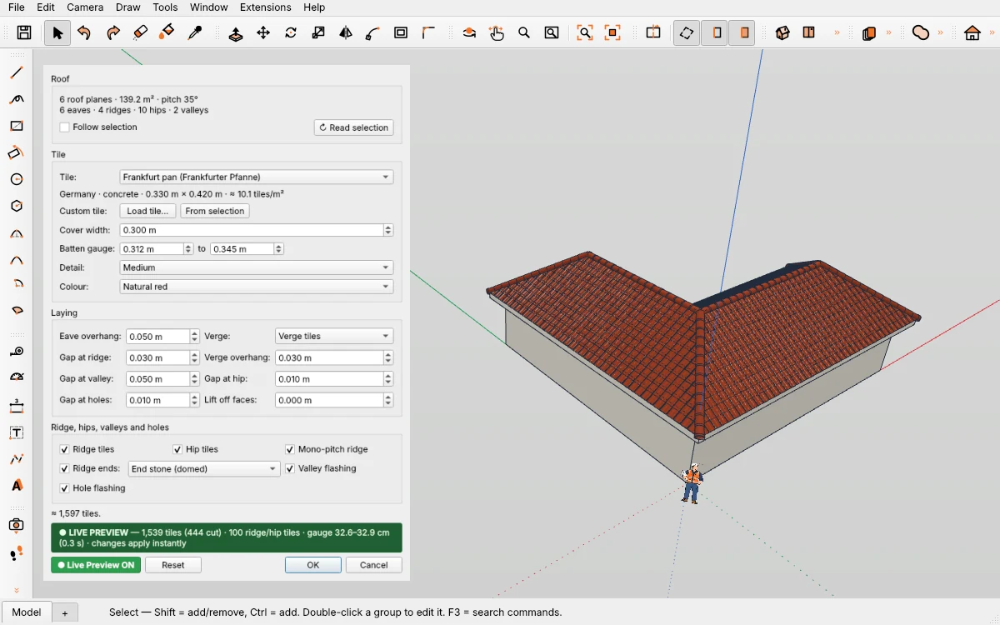
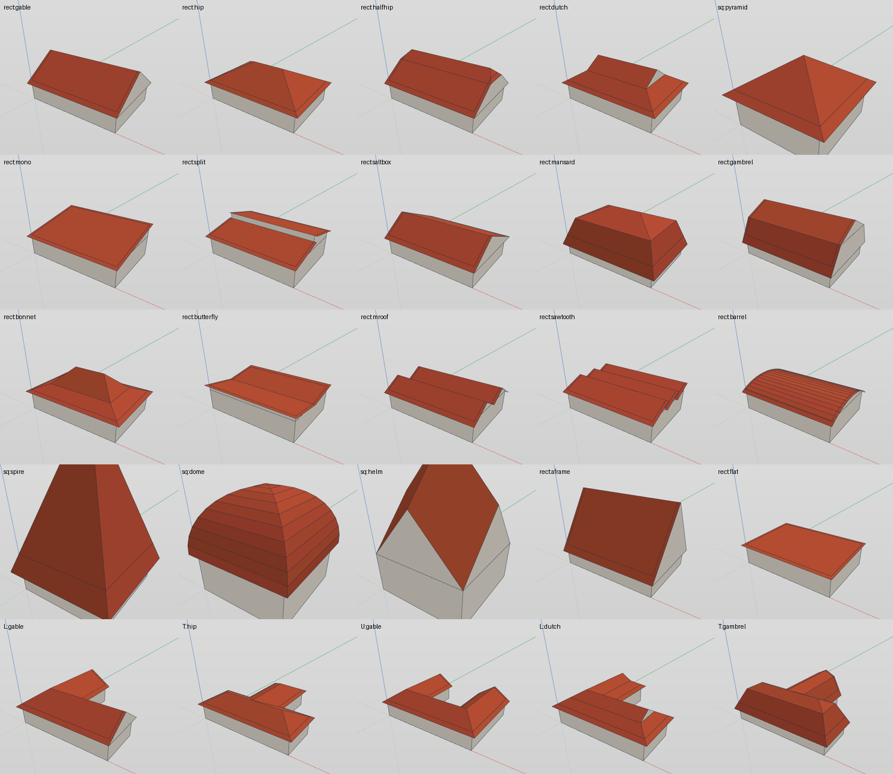
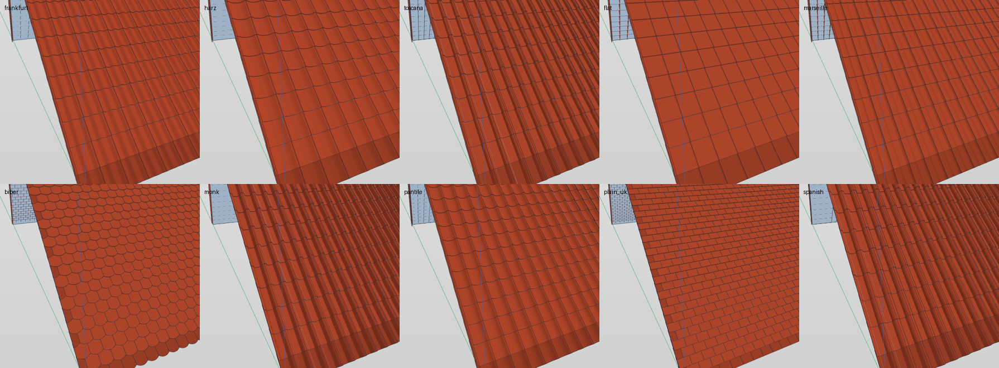
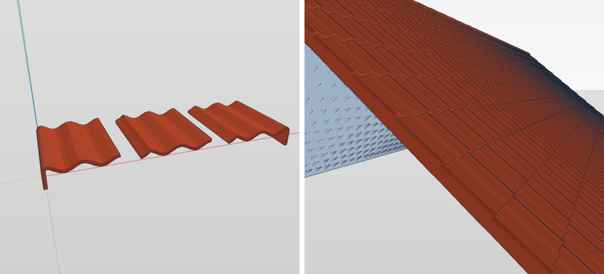
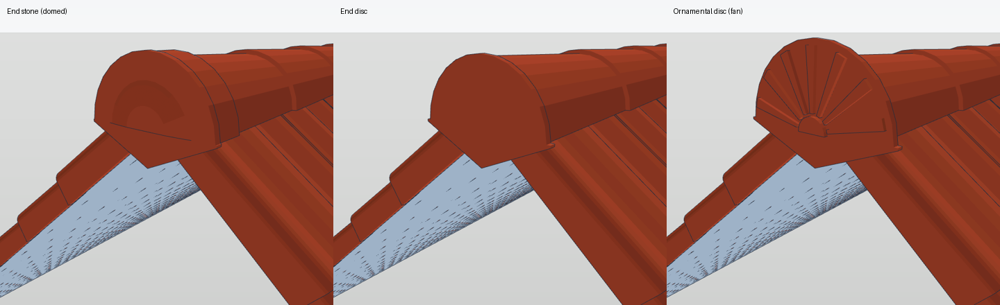
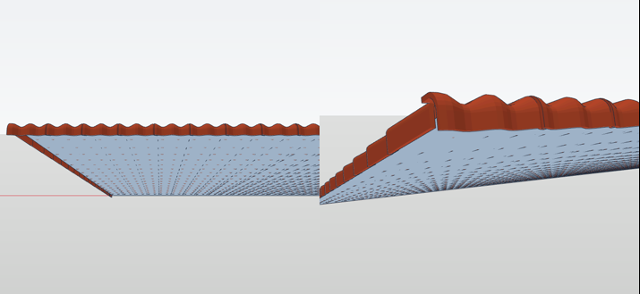
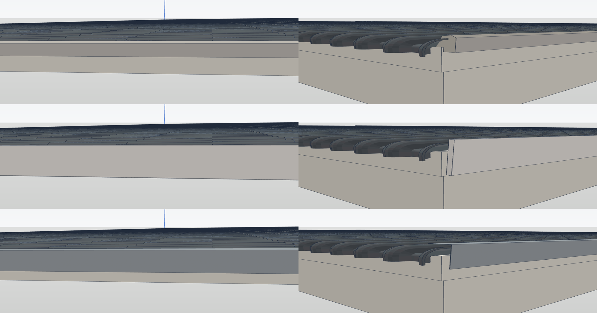

# Roof Tiles — Dächer bauen und mit echten 3D-Ziegeln eindecken in IngeTrazo

Zwei Werkzeuge in einem Plugin:

1. **Create Roof…** baut ein Dach auf einem Grundriss: 20 Dachformen aus Deutschland, Europa, Großbritannien, den USA und Asien.
2. **Cover Roof…** deckt beliebige Dachflächen mit echten 3D-Dachziegeln ein, mit Ortgangziegeln, Firstziegeln, Grat- und Firstenden.

## Installation
`roof_tile_tool.py` aus dem [neuesten Release](../../releases/latest) laden, in den Plugin-Ordner kopieren (Extensions ▸ Open plugins folder, unter Windows `%APPDATA%\ingetrazo\plugins`) und IngeTrazo neu starten. Braucht IngeTrazo ≥ 0.5.7 · getestet mit IngeTrazo 0.5.8.

Zu finden unter **Extensions ▸ Roof Tiles**, im Rechtsklickmenü und in der Werkzeugleiste «Roof Tiles» (4 Icons).

## Create Roof…
Waagerechte Fläche (Oberkante der Wände) oder einen Baukörper (Gruppe) auswählen ▸ **Create Roof…**. Die Seiten des Grundrisses werden im Viewport nummeriert.

- Dachformen: Satteldach, Walmdach, Krüppelwalm, Fußwalm / Dutch gable / Irimoya, Zeltdach, Pultdach, versetztes Pultdach, Saltbox / Catslide, Mansardwalmdach, Mansarddach (Gambrel), Aufschiebling (Bonnet), Schmetterlingsdach, Doppelsatteldach (M-roof), Sheddach, Tonnendach, Turmhelm / Kegeldach, Kuppel, Rhombendach, A-Frame, Flachdach mit Gefälle.
- Satteldach, Walmdach und Verwandte funktionieren auf **jedem Grundriss** (L, T, U, schief …): Grate, Kehlen und Kreuzgiebel entstehen von selbst (gewichtetes Straight Skeleton). Die übrigen Formen werden auf den Grundriss zugeschnitten.
- **Gable sides**: automatisch oder per Liste; **Turn the ridge 90°** dreht den First.
- Je Form: **Pitch**, **Pitch 2**, **Starts at**, **Break height**, **Height step**, **Teeth**, **Eave side**, **Eave overhang**, **Gable overhang**, **Gable walls**, **Roof thickness** (geschlossene Dachplatte mit Stirnbrett).
- Nach dem Bauen wird jede Fläche geprüft und bei Bedarf nach außen gedreht.
- **Cover with tiles after OK** öffnet gleich danach Cover Roof…. **Edit Roof Shape…** ändert das Dach später; eine Eindeckung darauf wird automatisch neu verlegt.

## Cover Roof…
Dachflächen (oder die Dach-Gruppe) auswählen ▸ **Cover Roof…**. Traufe, First, Grat, Kehle, Ortgang, Pultfirst, Mansard-Knick und Löcher werden erkannt. Jede Neigung lässt sich eindecken.

- 10 Ziegel und **11 Blechdächer** (siehe unten): Frankfurter Pfanne, Harzer Pfanne, Toscana, Flachdachpfanne, Marseiller, Biberschwanz, Mönch und Nonne, englische Pfanne, English plain tile, spanischer Ziegel — oder ein eigener Ziegel (.igz / .obj / Auswahl). Maße = typische Werte, keine Herstellerdaten.
- Lattweite und Deckbreite werden eingepasst, auch auf innere Ortgänge (die Stufe eines L).
- **Verge**: einteilige Ortgangziegel — oder bündig geschnitten und mit **Mörtelwulst**, **Windbrett** oder **Ortgangblech** abgeschlossen.
- Halbrunde Firstziegel; **Ridge ends** an den Firstenden und am Fuß jedes Grats (Gratanfänger): End stone (domed), End disc, Ornamental disc (fan).
- **Pultfirstziegel**: das Profil des Ziegels biegt über die Oberkante nach unten.
- Kehlblech (**Valley flashing**) und Eindeckrahmen um Dachfenster und Kamine (**Hole flashing**).
- Ganze Ziegel sind Instanzen, Randziegel echte Schnitte (manifold3d). Ein Undo-Schritt, Live Preview, **Edit Roof Tiles…**.

### Blechdächer (1.3)
Unter **Tile:** wie einen Ziegel wählen. Typische Profilmaße aus dem Handel, keine Herstellerdaten:

| Eindeckung | Profil (Rippenhöhe / Teilung) | Deckbreite | übliche Mindestneigung |
|---|---|---|---|
| Trapezblech 20/137 | Trapez 20 mm, 8 Rippen | 1,100 m | ≈ 7° |
| Trapezblech 35/207 | Trapez 35 mm, 5 Rippen | 1,035 m | ≈ 5° |
| Trapezblech 45/333 | Trapez 45 mm, 3 Rippen | 1,000 m | ≈ 5° |
| Wellblech 18/76 | Sinuswelle 18 mm, 14 Wellen | 1,064 m | ≈ 7° |
| Doppelstehfalz | Falz 25 mm | 0,500 m (Scharbreite) | ≈ 3° |
| Winkelstehfalz | Falz 22 mm, breit (Winkelfalz-Optik) | 0,500 m (Scharbreite) | ≈ 25° |
| Klemmfalz | runder Falz 25 mm, Sicken in der Schar | 0,510 m | ≈ 7° |
| Leistendeckung | Leistenkappe 50 mm | 0,600 m (Scharbreite) | ≈ 3° |
| Sandwichpaneel, Trapez | 4 Rippen 40 mm, Paneel 80 mm, flache Unterseite | 1,000 m | ≈ 5° |
| Pfannenblech (Dachpfannenprofil) | 6 Wellen 25 mm, Modul 350 mm, Stufe 15 mm | 1,100 m | ≈ 14° |
| Stahldachschindel | kleine flache Platten, Reihen versetzt | 0,600 m | ≈ 25° |

- Bleche werden **in einer Länge von Traufe bis First** verlegt (Feld **Sheet length**, voreingestellt 6 m; ein längerer Hang bekommt einen Querstoß). Am First, an Graten, Kehlen, Öffnungen und am Ortgang werden sie geschnitten — die Deckbreite wird **nicht** gestreckt, das letzte Blech wird geschnitten.
- Der Ortgang bekommt ein **Ortgangblech** (Ortgangziegel gibt es bei Blech nicht; die Wahl ergibt das Blech). Pultfirste bekommen den einfachen Pultabschluss.
- **First und Grate: Kantteile aus Blech, keine Firstziegel** — so, wie das Handwerk jede Eindeckung abschließt:
  - **Firstblech eckig** (Schenkel 200 mm in Dachneigung, Tropfkante) für Trapezblech, Sandwichpaneele und Schindeln;
  - **Rundfirst** (halbrundes Firstblech mit Schenkeln) für Wellblech und Pfannenblech;
  - **Stehfalz-Firstabdeckung** auf den Falzen, mit abgekanteten Rändern und Lüftungsspalt am First, für Doppel-, Winkel- und Klemmfalz;
  - **Firstleiste** (abgedeckte Leiste längs des Firsts) für Leistendeckung.
  Dieselben Teile laufen über die Grate (Gratblech); Firstenden und Gratfüße bekommen eine flache **Endplatte**. Ein durchgehendes Teil je First oder Grat, auf den Rippen bzw. Falzen aufliegend. Am Giebel laufen die Ortgangbleche unter das Firstblech und treffen sich am First auf Gehrung; das Firstblech endet 3 mm vor ihrer Außenseite und wird mit einer Endplatte bis auf ihre Oberkante geschlossen.
- Neue Farben: Anthrazitgrau, Graubraun, Oxidrot, Chromoxidgrün, Silber, verzinkt / Zink, Kupfer.
- Die Neigungswerte sind Richtwerte; maßgeblich sind die Vorgaben des Herstellers für das Blech und die Region.

| | |
|---|---|
|  |  |
|  |  |

## Einheiten
Der Dialog arbeitet in den **Einheiten des geöffneten Dokuments** — eingestellt in IngeTrazo unter **Fenster ▸ Einheiten…** (Strg+U) oder **Fenster ▸ Einstellungen… ▸ Einheiten**:
- Längenfelder zeigen und lesen die Längeneinheit und -form des Dokuments: m, cm, mm, in, ft, Fuß-Zoll (`9'10"`) oder Fuß-Zoll mit Brüchen (`9'10 1/8"`).
- Eingabe mit oder ohne Einheit: `25`, `2,5 cm`, `1'2"`, `3/4"`. Eine Zahl ohne Einheit gilt in der Dokumenteinheit (im Fuß-Zoll-Dokument: Zoll); ein Wert in einer anderen Einheit wird umgerechnet.
- Winkel stehen in der Winkeleinheit des Dokuments (Grad, Radiant oder Gon), Flächen in seiner Flächeneinheit; Prozentfelder und Anzahlen haben keine Einheit. Das Dezimaltrennzeichen folgt dem Dokument — beim Tippen gehen `.` und `,`.
- Ein Wechsel der Einheiten ändert nur Anzeige und Eingabe — das Modell bleibt exakt gleich. Nach dem Ändern den Dialog neu öffnen.
- In IngeTrazo-Versionen vor 0.5.8 sind die Felder einfache Zahlen in Metern.
- Deckbreite, Lattweite / Tafellänge, Überstände, Abstände und *Lift off faces* sind Längen in der Dokumenteinheit; die Vorlagen sind in Metern gespeichert und werden umgerechnet angezeigt. Die Neigung steht in der Winkeleinheit, die Dachfläche in der Flächeneinheit des Dokuments.

## Änderungen
- **1.3** — **Blechdächer**: Trapezblech 20/137, 35/207, 45/333, Wellblech 18/76, Doppel- und Winkelstehfalz, Klemmfalz, Leistendeckung, Sandwichpaneel (Trapez), Pfannenblech und Stahldachschindeln; Blechlänge statt Lattweite, Firstbleche und Gratbleche aus Blech (eckig, Rundfirst, Stehfalz-Firstabdeckung, Firstleiste), Ortgangblech, Metallfarben. **Dokumenteinheiten** in allen Feldern beider Dialoge (Längen, Neigung, %). Getestet mit IngeTrazo 0.6.0.
- **1.2.1** — verschobene, gedrehte oder gruppierte Dächer bleiben beim Bearbeiten, wo sie sind; die Ziegel werden neu gelegt, wenn sich die Dachform in einer Gruppe ändert. Getestet mit IngeTrazo 0.5.8.
- **1.2** — halbe Ziegel bei Biberschwanz im Halbverband, bündig geschnittene Ortgänge (keine schmalen Reststreifen), Brett- und Blechortgang um den Pultfirst.
- **1.1** — Ziegel als Komponenten zusammengefasst (viel weniger Objekte), Ziegel aus einem Stück, Pult-Ortgangziegel als ein Formteil, Traufreihe ganz gelegt.
- **1.0** — erste Veröffentlichung: Create Roof… (20 Dachformen auf beliebigem Grundriss) und Cover Roof… (echte 3D-Ziegel, Ortgänge, First, Grate, Bleche), Live-Vorschau.

## Hinweis
Produktnamen dienen nur der Beschreibung der Ziegelform; das Plugin steht in keiner Verbindung zu einem Ziegelhersteller.

Lizenz GPL-3.0-or-later · Pesi, [pesi3d.de](https://pesi3d.de) — English: [README.md](README.md)
