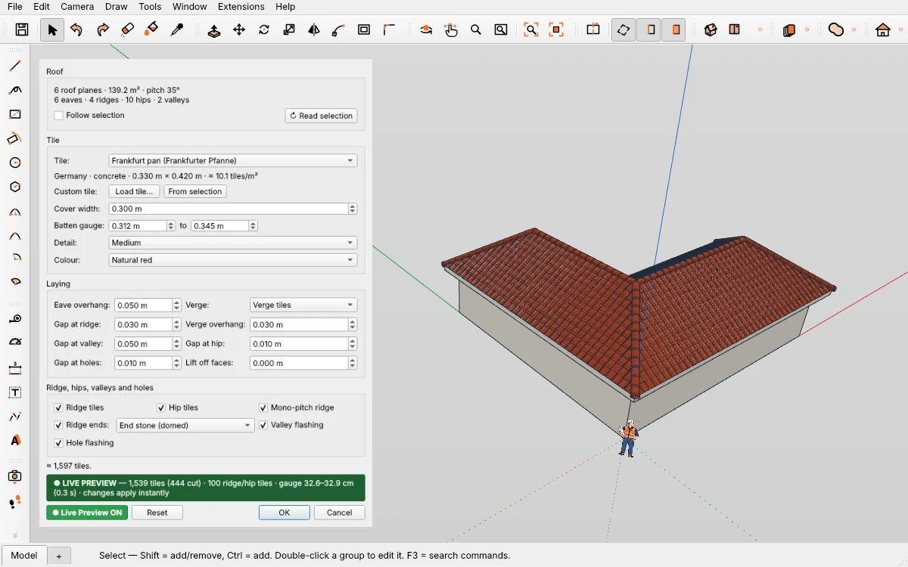
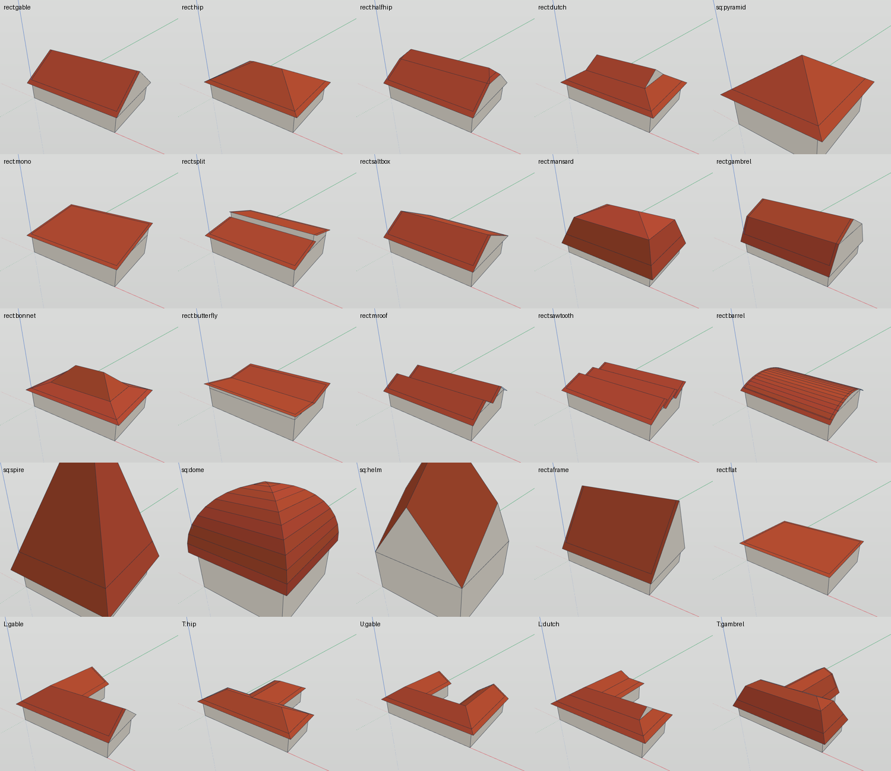
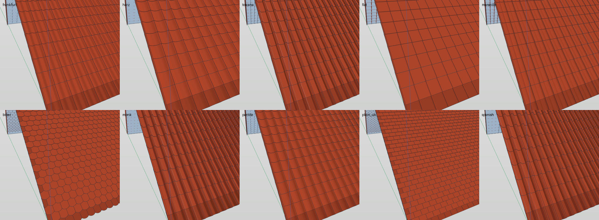
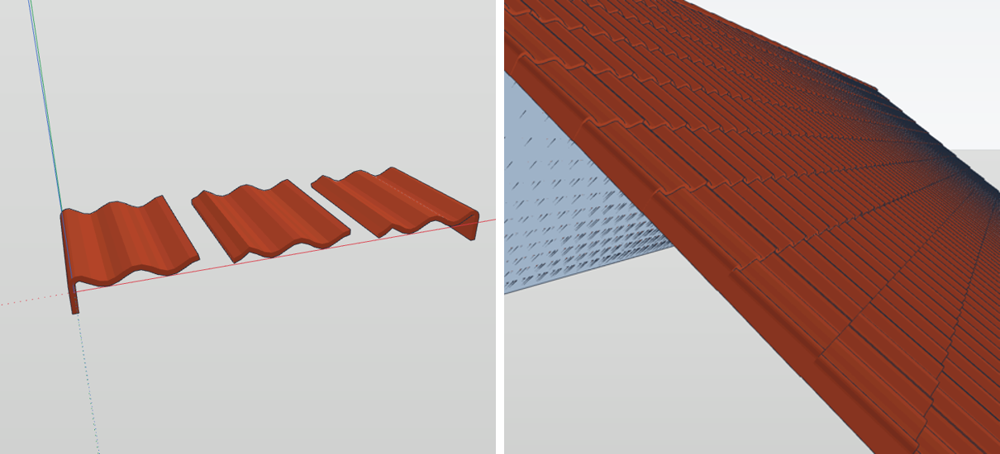
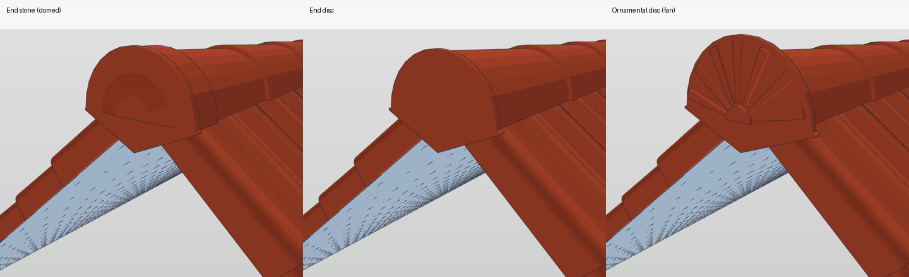
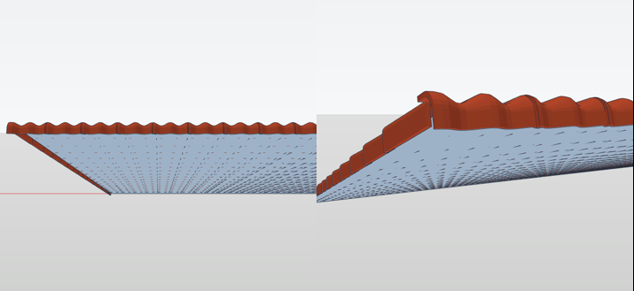
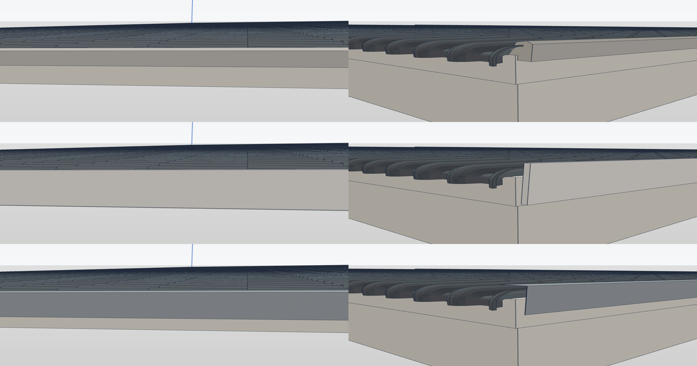

# Roof Tiles — build roofs and cover them with real 3D tiles in IngeTrazo

Two tools in one plugin:

1. **Create Roof…** builds a roof on a footprint: 20 roof shapes from Germany, Europe, the UK, the USA and Asia.
2. **Cover Roof…** covers any roof faces with real 3D roof tiles, with verge tiles, ridge tiles, hip and ridge end pieces.

## Install
Download `roof_tile_tool.py` from the [latest release](../../releases/latest), copy it into the plugins folder (Extensions ▸ Open plugins folder; on Windows `%APPDATA%\ingetrazo\plugins`) and restart IngeTrazo. Needs IngeTrazo ≥ 0.5.7 · tested with IngeTrazo 0.5.8.

You find it under **Extensions ▸ Roof Tiles**, in the right-click menu and in the «Roof Tiles» toolbar (4 icons).

## Create Roof…
Select a horizontal face (the top of the walls) or a building body (group) ▸ **Create Roof…**. The sides of the footprint are numbered in the viewport.

- Shapes: gable, hip, half-hip / jerkinhead, Dutch gable / gablet / irimoya, pyramid, mono-pitch / shed, split-level shed, saltbox / catslide, mansard, gambrel / barn, bonnet / bell-cast, butterfly, M-roof, sawtooth, barrel, spire / cone, dome, Rhenish helm, A-frame, flat with fall.
- Gable, hip and their kin work on **any footprint** (L, T, U, skewed …): hips, valleys and cross gables come by themselves (weighted straight skeleton). The other shapes are cut to the footprint.
- **Gable sides**: automatic or chosen in a list; **Turn the ridge 90°**.
- Per shape: **Pitch**, **Pitch 2**, **Starts at**, **Break height**, **Height step**, **Teeth**, **Eave side**, **Eave overhang**, **Gable overhang**, **Gable walls**, **Roof thickness** (a closed roof slab with fascia).
- Every face is checked after building and turned outward where needed.
- **Cover with tiles after OK** opens Cover Roof… right away. **Edit Roof Shape…** changes the roof later; a covering on it is laid again by itself.

## Cover Roof…
Select the roof faces (or the roof group) ▸ **Cover Roof…**. Eaves, ridges, hips, valleys, verges, mono-pitch ridges, mansard breaks and holes are read by themselves. Any pitch can be covered.

- 10 tiles and **11 steel sheet roofs** (see below): Frankfurt pan, Harz pan, Toscana, flat interlocking tile, Marseille tile, plain tile «Biberschwanz», monk and nun, English pantile, English plain tile, Spanish tile — or a tile of your own (.igz / .obj / selection). Typical dimensions, not any maker's data.
- Batten gauge and cover width are fitted, also to inner verges (the step of an L).
- **Verge**: one-piece verge tiles — or the tiles cut flush and closed with a **mortar bead**, a **verge board** or a **verge flashing**.
- Half-round ridge tiles; **Ridge ends** at the ridge and the foot of every hip: End stone (domed), End disc, Ornamental disc (fan).
- **Mono-pitch ridge tiles**: the tile's profile turned down over the top edge.
- **Valley flashing** and a flashing frame round roof windows and chimneys (**Hole flashing**).
- Whole tiles are instances, edge tiles are real cuts (manifold3d). One undo step, Live Preview, **Edit Roof Tiles…**.

### Steel sheet roofs (1.3)
Pick a sheet under **Tile:** like a tile. Typical profile sizes of the trade, not any maker's data:

| Covering | Profile (rib height / pitch) | Cover width | Usual lowest pitch |
|---|---|---|---|
| Trapezoidal sheet 20/137 | trapezoid 20 mm, 8 ribs | 1.100 m | ≈ 7° |
| Trapezoidal sheet 35/207 | trapezoid 35 mm, 5 ribs | 1.035 m | ≈ 5° |
| Trapezoidal sheet 45/333 | trapezoid 45 mm, 3 ribs | 1.000 m | ≈ 5° |
| Corrugated sheet 18/76 | sine wave 18 mm, 14 waves | 1.064 m | ≈ 7° |
| Standing seam, double lock | seam 25 mm | 0.500 m (bay) | ≈ 3° |
| Standing seam, angle seam | seam 22 mm, wide (angle-seam look) | 0.500 m (bay) | ≈ 25° |
| Snap-lock standing seam | rounded seam 25 mm, beads in the pan | 0.510 m | ≈ 7° |
| Batten roll | batten cap 50 mm | 0.600 m (bay) | ≈ 3° |
| Sandwich panel, trapezoidal | 4 ribs 40 mm, 80 mm panel, flat underside | 1.000 m | ≈ 5° |
| Tile-effect steel sheet | 6 waves 25 mm, module 350 mm, step 15 mm | 1.100 m | ≈ 14° |
| Steel roof shingle | small flat panels, rows offset | 0.600 m | ≈ 25° |

- Sheets are laid **eave → ridge in one length** (field **Sheet length**, 6 m preset; a longer slope gets an end lap). They are cut at the ridge, at hips, valleys, holes and at the verge — the cover width is **not** stretched, the last sheet is cut.
- The verge is closed with a **verge flashing** (verge tiles do not exist for metal; choosing them gives the flashing). Mono-pitch ridges get the plain mono-pitch flashing.
- **Ridge and hips: metal flashings, no ridge tiles** — as the trade closes each covering:
  - **Angular ridge flashing** (legs 200 mm at the roof's pitch, drip edge) for trapezoidal sheets, sandwich panels and shingles;
  - **Half-round ridge capping** with flanges for corrugated and tile-effect sheets;
  - **Standing seam ridge cover** lying on the seams, turned-down edges, vented gap at the ridge, for double-lock, angle and snap-lock seams;
  - **Batten roll ridge** (capped batten along the ridge) for batten roll roofs.
  The same pieces run up the hips (Gratblech); ridge ends and hip feet get a flat **end plate**. One continuous piece per ridge or hip, resting on the rib tops / seams. At the gable the verge flashings run up under the ridge flashing and meet mitred at the ridge; the ridge flashing ends 3 mm past their face and is closed with an end plate down to their top.
- New colours: Anthracite grey, Grey brown, Oxide red, Chrome green, Silver, Galvanised / zinc, Copper.
- The pitch values are guide values; the maker's rules for your sheet and region decide.

| | |
|---|---|
|  |  |
|  |  |

## Units
The dialog works in the **units of the open document** — set in IngeTrazo under **Window ▸ Units…** (Ctrl+U) or **Window ▸ Preferences… ▸ Units**:
- Length fields show and take the document's length unit and form: m, cm, mm, in, ft, feet-and-inches (`9'10"`) or fractional feet-and-inches (`9'10 1/8"`).
- Type with or without a unit: `25`, `2,5 cm`, `1'2"`, `3/4"`. A number without a unit is in the document's unit (inches in a feet-and-inches document); a value typed in another unit is converted.
- Angles are in the document's angle unit (degrees, radians or gon), areas in its area unit; per-cent fields and counts have no unit. The decimal separator follows the document — `.` and `,` are both accepted when typing.
- Changing the units only changes how values are shown and typed — the model stays exactly as it is. Open the dialog again after changing them.
- On IngeTrazo builds before 0.5.8 the fields are plain numbers in metres.
- Cover width, gauges / sheet length, overhangs, gaps and *Lift off faces* are lengths in the document's unit; the presets are stored in metres and shown converted. Pitch is in the document's angle unit, the roof area in its area unit.

## Changelog
- **1.3** — **steel sheet roofs**: trapezoidal sheets 20/137, 35/207, 45/333, corrugated sheet 18/76, double-lock and angle standing seam, snap-lock seam, batten roll, trapezoidal sandwich panel, tile-effect steel sheet and steel roof shingles; sheet length instead of batten gauge, metal ridge and hip flashings (angular, half-round, standing seam cover, batten roll), verge flashing, metal colours. **Document units** in every field of both dialogs (lengths, pitch, %). Tested with IngeTrazo 0.6.0.
- **1.2.1** — moved, rotated or grouped roofs stay where they are when edited; tiles are laid again when the roof shape inside a group changes. Tested with IngeTrazo 0.5.8.
- **1.2** — half tiles for half-bond tiles, cut-flush verges (no thin strips left), board and metal verges round a mono-pitch ridge.
- **1.1** — tiles combined into components (far fewer objects), tiles in one piece, mono-pitch verge tile as one moulded part, eave course laid whole.
- **1.0** — first release: Create Roof… (20 roof shapes on any footprint) and Cover Roof… (real 3D tiles, verges, ridges, hips, flashings), Live Preview.

## Note
Product names only describe the tile shape; this plugin is not affiliated with any tile maker.

License GPL-3.0-or-later · Pesi, [pesi3d.de](https://pesi3d.de) — German: [LIESMICH.md](LIESMICH.md)
